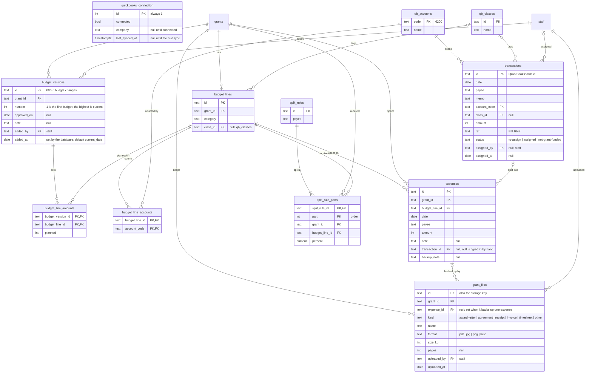
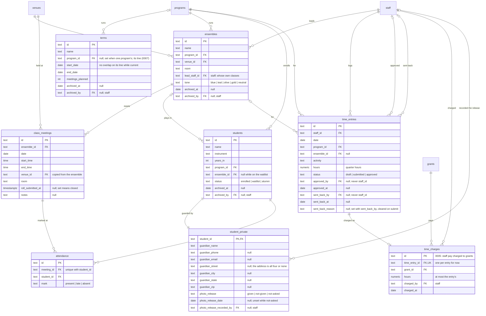

# Schema for the backend

The tables the backend starts from, derived from the domain types each part of the portal already
has (`src/core/types.ts`, `src/core/auth.ts`, and each module's `domain/types.ts`) and from the
decisions in `docs/decisions/`. It is a design, not a migration: no SQL. The product is Postgres on Supabase, with Supabase sign-in
and Supabase Storage for file contents (decision 0009); the migrations in `supabase/migrations/`
are built from this, one per diagram (#153), and `npm run test:db` checks the database they build
against the diagrams: the same tables and columns, each column's type, and `null` exactly where a
diagram says so. A change to a diagram comes with a migration.
Where a table differs from its type, the table says why; no type in `src/` changes for it. If a
type turns out to be wrong for a table, file an issue rather than bend the table.

## Conventions

- **Money is integer dollars and dates are ISO**, as everywhere in the portal: every amount is an
  `int` of whole US dollars, every date a `date` (`YYYY-MM-DD`). The few instants are
  `timestamptz`: an activity row's `at`, a roll call's `roll_submitted_at`, the last QuickBooks
  sync. Hours are `numeric(5,2)` in quarter-hour steps; a class's start and end are `time`.
- **Names.** Tables and columns are `snake_case` of the type's fields: `Grant.amountAwarded` is
  `grants.amount_awarded`, `archivedById` is `archived_by`.
- **Ids** are `text`, as today. The seeded ids stay (`studio-sessions`; Operations keeps
  `general-operating`, decision 0006), so saved data and exports load unchanged; new rows may get
  generated ids. A generated id is made in the browser before the change is first sent, as a
  prefix and the full 32 hex characters of `crypto.randomUUID()` (`g-3f9c…`, 122 random bits), so
  a resent insert is an upsert of the same row (decision 0008, #126). An id derived from its
  parent's (`<grant id>-t1` for a new grant's tasks, `<entry id>:1` for a time entry's steps) is
  made only in the change that inserts the parent. Ids saved before this, 10 hex characters, stay
  valid.
- **Enums** are the type's string unions, kept as `text` with a check (or a Postgres enum). The
  diagrams list the values for reading; the type is the source of truth, and a value added there
  is added to the check.
- **Nested shapes become columns or child tables.** A one-to-one shape becomes columns
  (`Grant.dates` becomes eight date columns, `Venue.address` four); a list becomes a child table
  (`Grant.programs` is `grant_programs`, `OfficeDocument.versions` is
  `office_document_versions`). A list of plain values that point at nothing stays an array
  column: reminder offsets (`int[]`) and the modules switched on (`text[]`). The one `jsonb`
  column is a time entry step's `activity.detail`, which only the History dialog reads.
- **The mapping in code.** Each slice turns its state into these tables' rows and back
  (`tables` on the slice, `src/core/rows.ts`, #121), so the row diff of decision 0008 knows
  which table each change lands in.
- **Singletons.** The office's settings, its QuickBooks connection and its reminder defaults are
  one row each.
- **No list order.** A database gives rows back in no order, so nothing depends on where a row
  sits in a list (#131). Where order matters it is a column: `sort_order` on the ordered lists,
  `number` on budget versions and office document versions. A grant's programs have no order
  column: they are read sorted by program name.
- **Nullable** is marked `null` in the diagrams and "yes" in the tables below; every other column
  is `not null`. A cleared field is written as `null`: the browser keeps it as a missing field,
  the change sent to the database names the column with `null`, and a `null` read back becomes a
  missing field again (decision 0008, #122, #123).

## What is not stored

Derived data is left out on purpose, as SPEC section 2 says ("Derived data (never stored)"):
deadlines, per-grant money (received, expected, spent, remaining, planned total), pacing,
suggestions for transactions, reports owed and the reminder schedule, fiscal-year totals,
pipeline counts. The same holds for what the modules work out the same way: attendance summaries
and program numbers, hours by program and week totals, a grant's standing and warnings, what a
grant has "not yet given", the current version of an office document, the current version of a
budget, a target's progress.

Also not tables: the shapes that exist only to carry an action or a screen (`NewGrantInput`,
`RenewGrantInput`, `InFlightInput`, `GiveShareInput`, `ShareTargetInput`, `ShareChange`,
`ProjectInput`, `StudentInput`, `TermInput`, `EnsembleInput`, `NewTimeEntryInput`, the office
document inputs, `Allocation`), the undo shapes (`TransactionSnapshot`, `BackupCarry`), the
suggestion shape (`UsualShares`), `FiscalYear` (worked out from the settings' start month and a
`FiscalYearLabel` such as "FY27"), `FundingTarget` (stored as the columns of `grant_shares`),
`SignedInUser` (the session's view of a staff row), and `GrantsState.incoming` (a demo device for
"what the next sync brings"; with a backend the sync inserts into `transactions`).

## Diagrams

One diagram per area, so each stays readable. A table from another area appears as a name only,
to show the link; its columns are in its own diagram. One link is left out of the drawings because
it is on eleven tables: every `archived_by` references `staff`, zero or one person to any number
of archived rows. Cardinality is read the Mermaid way: `||`
exactly one, `|o` zero or one, `}o` zero or more, `}|` one or more. Every foreign key is
`on delete restrict`: nothing cascades (decision 0002). The tables marked "0005" do not exist in
the browser build yet; they are the room decision 0005 asked the schema to leave.

### Core: people, programs, partners, office documents, the activity log

```mermaid
erDiagram
  staff {
    text id PK
    text name
    text title
    text role "admin | director | office-manager | bookkeeper | teacher | assistant | read-only"
    bool teaches
    text email "null; required once the record has a login; where the invitation goes; stored lower-case, unique among current staff"
    date archived_at "null"
    text archived_by FK "null; staff"
  }
  logins {
    uuid auth_user_id PK "the Supabase user (auth.users), made by the invitation; the email and password live there"
    text staff_id FK,UK "one sign-in per person"
    text invited_by FK "staff"
    timestamptz invited_at
    timestamptz accepted_at "null"
  }
  programs {
    text id PK "general-operating is Operations"
    text name
    text short
    bool in_school "false on Operations"
    date archived_at "null"
    text archived_by FK "null; staff"
  }
  program_budgets {
    text program_id PK, FK
    text fiscal_year PK "FY27"
    int amount
  }
  projects {
    text id PK
    text name
    text program_id FK
    date start_date
    date end_date
    int budget
    date archived_at "null"
    text archived_by FK "null; staff"
  }
  organizations {
    text id PK
    text name
    text kind "school-district | school | community | government | other"
    text contact_name "null"
    text contact_email "null"
    text contact_phone "null"
    text website "null"
    text notes "null"
    date archived_at "null"
    text archived_by FK "null; staff"
  }
  venues {
    text id PK
    text name
    text kind "studio | school | community | performance | other"
    text organization_id FK "null"
    text street "null; the address is all four or none"
    text city "null"
    text state "null"
    text zip "null"
    text contact_name "null"
    text contact_email "null"
    text contact_phone "null"
    text notes "null"
    date archived_at "null"
    text archived_by FK "null; staff"
  }
  office_documents {
    text id PK
    text kind "irs-letter | financials | board-list | insurance-certificate | w9 | organization-budget | other"
    text name
    date archived_at "null"
    text archived_by FK "null; staff"
  }
  office_document_versions {
    text id PK "also the storage key"
    text office_document_id FK "unique with number"
    int number "1, 2, 3 per document in the order added; breaks a same-day tie"
    text name "the file's name"
    text format "pdf | jpg | png | heic"
    int size_kb
    int pages "null"
    date added_at
    text added_by FK "staff"
    date expires "null"
  }
  settings {
    int id PK "always 1"
    int fiscal_year_start_month "1-12"
    text[] enabled_modules
  }
  activity {
    text id PK
    text subject_kind "grant, funder, time-entry; later student, ensemble, program, project"
    text subject_id
    timestamptz at
    text who_id FK "null; staff"
    text who "null; a name saved before rows carried an id"
    text text
    text kind "null; a time entry's step: logged | changed | submitted | recalled | approved | sent-back"
    jsonb detail "null; a step's reason, changed fields, rebuilt and undated flags"
  }

  staff ||--o| logins : "signs in as"
  staff ||--o{ logins : "invited"
  programs ||--o{ program_budgets : "costs, per year"
  programs ||--o{ projects : "has"
  organizations |o--o{ venues : "owns"
  office_documents ||--|{ office_document_versions : "has"
  staff ||--o{ office_document_versions : "added"
  staff |o--o{ activity : "did"
```

### Grants: the pipeline, the award, the register, reminders and the playbook

```mermaid
erDiagram
  funders {
    text id PK
    text name
    text type "foundation | government | corporate | individual | other"
    text contact_name "null"
    text contact_email "null"
    text contact_phone "null"
    text website "null"
    text cycle_notes "null"
    text notes "null"
    date archived_at "null"
    text archived_by FK "null; staff"
  }
  grants {
    text id PK
    text funder_id FK
    text title
    text restriction "restricted | unrestricted"
    text owner_id FK "staff"
    text phase "prospect | loi | applying | submitted | awarded | active | reporting | closed | declined | withdrawn"
    bool loi_required
    int amount_requested "null"
    int amount_awarded "null"
    date start_by "null"
    date loi_due "null"
    date application_due "null"
    date submitted "null"
    date decision_expected "null"
    date decided "null"
    date period_start "null"
    date period_end "null"
    text notes "null"
    date created_at
    text brought_in_phase "null; both or neither"
    date brought_in_on "null"
    text renews_grant_id FK, UK "null; grants"
    date archived_at "null"
    text archived_by FK "null; staff"
  }
  grant_programs {
    text grant_id PK, FK "no order; read sorted by program name"
    text program_id PK, FK
  }
  grant_shares {
    text id PK
    text grant_id FK
    text target_kind "program | project"
    text program_id FK "null; set with fiscal_year when program"
    text fiscal_year "null"
    text project_id FK "null; set when project"
    int amount "more than 0"
  }
  tasks {
    text id PK
    text grant_id FK
    text phase
    text title
    date due_date "null"
    text assignee_id FK "null; staff"
    bool done
    date done_at "null"
    int sort_order
  }
  grant_documents {
    text id PK
    text grant_id FK
    text name
    text kind "narrative | budget | irs-letter | board-list | financials | insurance-certificate | w9 | organization-budget | award-letter | agreement | report | other"
    text status "needed | drafting | final | submitted"
    text url "null"
    text office_document_id FK "null"
    date updated_at
  }
  payments {
    text id PK
    text grant_id FK
    text label
    date expected_date
    int amount
    date received_date "null"
    int source_page "null"
    text deposit_id "null; 0005: the deposit it arrived as, a foreign key once deposits exist"
  }
  award_terms {
    text id PK
    text grant_id FK
    text label
    text text
    int page "null"
    int sort_order
  }
  grant_targets {
    text id PK "0005: deliverables"
    text grant_id FK
    text award_term_id FK "null"
    text label "serve 120 students"
    int target
    int sort_order
  }
  reports {
    text id PK
    text grant_id FK
    text kind "interim | final"
    date due_date
    date submitted_date "null"
    text status "upcoming | drafting | submitted | accepted"
  }
  reminder_plans {
    text report_id PK, FK
    int[] offsets "days before due"
    bool keep_reminding
  }
  reminder_plan_recipients {
    text report_id PK, FK
    text staff_id PK, FK
  }
  reminder_defaults {
    int id PK "always 1"
    int[] offsets "days before due"
    bool keep_reminding
    int repeat_every_days
    int send_hour "0-23"
  }
  reminder_default_recipients {
    text staff_id PK, FK "also notified"
  }
  checklist_templates {
    text id PK
    text name
    text description "null"
  }
  checklist_template_items {
    text id PK
    text template_id FK
    text phase
    text title
    int offset_days "negative is before"
    text anchor "a grant date, as the type names it: startBy | loiDue | applicationDue | submitted | decisionExpected | decided | periodStart | periodEnd"
    int sort_order
  }

  funders ||--o{ grants : "funds"
  staff ||--o{ grants : "owns"
  grants |o--o| grants : "renews"
  grants ||--|{ grant_programs : "is for"
  programs ||--o{ grant_programs : "named by"
  grants ||--o{ grant_shares : "shares out"
  programs |o--o{ grant_shares : "gets, per year"
  projects |o--o{ grant_shares : "gets"
  grants ||--o{ tasks : "has"
  staff |o--o{ tasks : "assigned"
  grants ||--o{ grant_documents : "registers"
  office_documents |o--o{ grant_documents : "used by"
  grants ||--o{ payments : "expects"
  grants ||--o{ award_terms : "has"
  grants ||--o{ grant_targets : "promises"
  award_terms |o--o{ grant_targets : "source of"
  grants ||--o{ reports : "owes"
  reports ||--o| reminder_plans : "follows"
  reminder_plans ||--o{ reminder_plan_recipients : "emails"
  staff ||--o{ reminder_plan_recipients : "gets"
  staff ||--o{ reminder_default_recipients : "gets"
  checklist_templates ||--o{ checklist_template_items : "lists"
```

### Money: budgets, expenses, QuickBooks, files

### Teaching and timesheets

## Links across modules

Today a module never holds another module's record, only its id, so that timesheets never depends
on teaching and grants never on QuickBooks code (PLATFORM 1.5). In the database these become real
foreign keys; the modules still read each other only through their `index.ts`.

| Link today | In the database |
| --- | --- |
| `TimeEntry.ensembleId` (timesheets to teaching) | `time_entries.ensemble_id` references `ensembles`, nullable: zero or one ensemble, an ensemble has any number of entries |
| `Grant.programs` (grants to core) | `grant_programs`, a grant to each of its programs: one or more per grant ("at least one" is checked on write), any number of grants per program. No order is kept: the portal shows a grant's programs sorted by name (#131) |
| `Expense.transactionId` (an expense to the QuickBooks transaction it is a part of) | `expenses.transaction_id` references `transactions`, nullable: a transaction is split into zero (to assign, set aside) or more expenses, and an expense typed in by hand has none |
| `GrantShare.target` (grants to core's program budgets and projects) | `grant_shares.program_id` with `fiscal_year`, or `project_id`; a check makes it exactly one of the two |
| `GrantDocument.officeDocumentId` (grants to core) | `grant_documents.office_document_id`, nullable |
| `Ensemble.venueId`, `ClassMeeting.venueId`, `Ensemble.leadStaffId`, every `programId` and staff id in a module | Foreign keys to the core tables |
| `Activity.grantId` (grants' own log) | `activity.subject_kind = 'grant'` and `subject_id`, no foreign key, since the subject can be any kind |
| `TimeEntry.history` (each entry's own steps, #95) | Rows of `activity` with `subject_kind = 'time-entry'` and `subject_id` the entry's id, one per step: `who_id` from `whoId`, `at` from the step's date, `text` from the step ("Approved", "Sent back: reason", "Changed: hours 1.25 to 1.50"). `kind` is the step's kind and `detail` what else it carries (a send back's `reason`, a change's `changes` with each field before and after, `rebuilt`), so the History dialog reads the step as it was recorded, not back out of `text` (#121). Until the backend they live on the entry, saved with it. A step rebuilt from an entry saved before #95 has no date for logged and submitted; it takes the entry's `date` as `at` when moved, and `detail.undated` says so |
| `time_charges.grant_id` (timesheets to grants, 0005) | New: references `grants` |

## Archive, and no cascading deletes

Eleven tables are archivable today, every type that extends `Archivable` (decision 0002, built in
#20, then #44 and #66): `staff`, `programs`, `projects`, `organizations`, `venues`,
`office_documents`, `funders`, `grants`, `terms`, `ensembles`, `students`. Each has `archived_at
date null` and `archived_by text null references staff`; both null means current. Archiving and
restoring are ordinary updates of those two columns.

**There are no cascading deletes on them**, and no deletes at all: no row of these eleven is ever
deleted, and nothing that points at one is removed with it (archiving a funder leaves its grants,
a partner its venues, a class its students). Every foreign key in the schema is `on delete
restrict`.

Smaller rows that are mistakes rather than history may still be deleted, with the checks the
store makes today (decision 0002): a checklist task, a register row, a payment not yet received,
a budget line with no expenses, an expense, a file, an award term, a report not yet sent, a split
rule, a checklist template, a grant share (Take back), a time entry while it is a draft, and a
transaction's parts when it is sent back or reassigned. A file that backs up an expense goes with its expense, in the
same change, with its stored contents; that is the change doing it, not a cascade.
`office_document_versions` and `activity` are insert-only.

## Files

A file's contents are never a column. They live in a private Supabase Storage bucket (decision
0009), one for grant files and one for office document versions, keyed by the row's id:

- **`grant_files`**: the award letter, a signed agreement, and the backup (receipt, invoice,
  timesheet) for one expense. The table keeps what `GrantFile` has: the file's facts (core's
  `FileFacts`: name, format, size in KB, pages), its kind, the grant, the expense it backs up if
  any, who uploaded it and when. The object's key is the row's `id`.
- **`office_document_versions`**: one row per version of an office document, insert-only. The
  table keeps the file's facts, when it was added and by whom, and when it expires; the object's
  key is the version's `id` (decision 0005). Each version has a `number`, 1, 2, 3 within its
  document and unique with `office_document_id`: the highest held plus one, made in the browser
  before the insert is first sent, so a resent insert keeps it, and never changed (#131). The
  current version is the newest added, the higher `number` winning a same-day tie, worked out,
  not stored; a grant's register row stores the document, and the version it sent is the one
  current on the grant's submitted date.
- **`grant_documents`** keeps no file: a register row is a name, a kind, a status and either a
  link out (`url`) or the office document it uses.

The bucket follows the row: whoever may read the row may read its object, and whoever may write
the row may add its object. The browser build keeps only the facts (a known gap,
`docs/FEATURES.md`).

## Row-level security

Decision 0001 becomes the database's rules: the screens hide what the database would refuse
anyway. Every request carries the signed-in person's Supabase user; `current_staff_id()` and
`current_role()` turn it into their staff id and `staff.role` through `logins`, and return nothing
for an archived person, who is shut out at once (decision 0009). Below, a role is in a cell when the 0001 table gives it that, in the
table's own words; "Read" is any of View, View all, Edit, Yes, Any class, Own, Own classes;
"Write" is Edit, Yes, Any class, Own, Own classes.

**As built (#154).** The two functions are `private.current_staff_id()` and
`private.current_role()`, in a schema the REST API does not expose, executable only by
`authenticated`; nothing in the token (`user_metadata`) is read. Every table has one policy per
command, all `to authenticated`, and each names its roles: "everyone signed in" means
`current_role()` is not null, so an archived person or a user with no `logins` row reads nothing.
`anon` is granted nothing, and nobody signed in may truncate. "Write" means insert and update; a
delete policy exists only where a row may be deleted (above, "Archive, and no cascading
deletes"): none on the eleven archivable tables, the singletons, `transactions`, `qb_accounts`,
`qb_classes`, `office_document_versions` or `activity`. `logins` has no write policy: only the
invitation writes it, with the secret key (#157). What a policy cannot see, the row before the
change, is left to triggers (#155): the moves between statuses, nobody changing their own role,
Operations, the closed roll, which columns a Teacher or a sync may change, and the "by" columns.
The migration is `supabase/migrations/*_row_rules.sql`; `db/policies/row-rules.test.sql` signs in
as each role, an archived person and a user with no login, and reads and writes every table.

**The own-rows rules.**

- **Own classes** (Teacher): the ensembles whose `lead_staff_id` is the person, their
  `class_meetings`, the `students` whose `ensemble_id` is one of them, those students'
  `student_private` row, and the `attendance` at those meetings.
- **Own hours** (every role but Read-only): the `time_entries` whose `staff_id` is the person.
  Nobody approves their own: an approval sets `approved_by` and is refused when it equals
  `staff_id`.

**Guardian columns.** A student's guardian name, phone, email and address and their photo release
(`photo_release`, its date, who recorded it) are the most protected data in the portal. They sit
in their own table, `student_private`, one row per student, so a row rule can protect them: the
`Student` type keeps them on the student, and the backend joins them in only for someone allowed
(today `asSeenBy` and `rosterFor` leave them off). They are still the student's columns, as
decision 0005 says of the photo release, held one-to-one beside the student. The rows of
`students` themselves carry no guardian data.
The guardian's email and address are optional (decision 0004, #82); `Student.guardianAddress` is
core's `Address`, so it becomes four columns, all four or none, as on a venue.

| Table | Who may read | Who may write | Row in 0001 |
| --- | --- | --- | --- |
| `staff` | Everyone signed in (names show everywhere) | Admin, Director; nobody changes their own role, and only an Admin or a Director touches an Admin's row | Staff and roles |
| `logins` | Admin, Director | By invitation only (0001, "Sign-ins are by invitation"): Admin, Director invite a current staff record; only an Admin invites for an Admin's record; nobody sets another's password, and every new sign-in shows to every Admin | Staff and roles |
| `programs` | Everyone signed in | Admin, Director, Office manager; Operations is never archived, renamed or in-school | Programs: add, rename, archive |
| `program_budgets`, `projects` | Admin, Director, Office manager, Bookkeeper, Office assistant, Read-only | Admin, Director, Office manager, Bookkeeper | Program budgets and projects |
| `organizations`, `venues` | Everyone signed in | Admin, Director, Office manager | Partners and venues |
| `office_documents`, `office_document_versions` | Admin, Director, Office manager, Bookkeeper, Office assistant, Read-only | Admin, Director, Office manager, Bookkeeper (versions: insert only) | Office documents |
| `settings` | Everyone signed in | Admin | Modules, import, export |
| `activity` | Whoever may read the subject's row | Inserted with the change it records, by whoever may make that change; never updated or deleted | The subject's row |
| `funders`, `grants`, `grant_programs`, `tasks`, `grant_documents`, `checklist_templates`, `checklist_template_items`, `reminder_plans`, `reminder_plan_recipients`, `reminder_defaults`, `reminder_default_recipients` | Admin, Director, Office manager, Bookkeeper, Office assistant, Read-only | Admin, Director, Office manager, Office assistant; the award amount and a move into Awarded and after also need "Award, budget, reports" | Grants: pipeline, checklist, deadlines |
| `payments`, `award_terms`, `reports`, `budget_versions`, `budget_lines`, `budget_line_amounts`, `budget_line_accounts`, `expenses`, `grant_targets` | Admin, Director, Office manager, Bookkeeper, Office assistant, Read-only | Admin, Director, Office manager, Bookkeeper | Award, budget, reports |
| `grant_shares` | Admin, Director, Office manager, Bookkeeper, Office assistant, Read-only | Admin, Director, Office manager, Bookkeeper | Grant shares |
| `transactions`, `split_rules`, `split_rule_parts` | Admin, Director, Office manager, Bookkeeper, Read-only | Admin, Director, Office manager, Bookkeeper (assign, split, set aside; never the QuickBooks columns) | Transactions: assign, split |
| `grant_files` | A grant's own files: as "Grants: pipeline"; an expense's backup: as "Award, budget, reports" | The same rows' writers | Grants, or Award |
| `quickbooks_connection`, `qb_accounts`, `qb_classes` | Admin, Director, Office manager, Bookkeeper, Office assistant, Read-only (a budget line shows its accounts and class) | Connect: Admin. Sync (`last_synced_at`, accounts, classes, new transactions): Admin, Director, Office manager, Bookkeeper, through the sync | QuickBooks: connect, QuickBooks: sync |
| `terms`, `ensembles`, `class_meetings` | Admin, Director, Office manager, Teacher (View all), Office assistant, Read-only | Admin, Director, Office manager; a Teacher closes and reopens the roll on their own classes' meetings | Schedule and classes |
| `students` | Admin, Director, Office manager, Office assistant; Teacher: own classes. Read-only: counts only, through a counting function, never the rows. Bookkeeper: none | Admin, Director, Office manager | Students: names, attendance |
| `student_private` | Admin, Director, Office manager; Teacher: own classes. Never the Office assistant, the Bookkeeper or Read-only | Admin, Director, Office manager (whoever edits the student); `photo_release_recorded_by` is always the person writing | Guardian contact details |
| `attendance` | Admin, Director, Office manager, Office assistant; Teacher: own classes. Read-only: counts only | Admin, Director, Office manager (any class); Teacher: own classes; none once the meeting's roll is submitted | Roll call |
| `time_entries` | Own hours, for every role but Read-only; all rows for Admin, Director, Office manager, Bookkeeper | Insert: own hours, as a draft. Change and delete: own hours, only while a draft. Submit (draft to submitted) and recall (submitted to draft): own hours. Approve (submitted to approved): Admin, Director, Office manager, Bookkeeper, never their own. Send back (approved to draft, with `sent_back_reason` required; sets `sent_back_by` to the writer and `sent_back_at`, clears `approved_by` and `approved_at`): the same roles, never their own. Submitting clears `sent_back_reason` and keeps `sent_back_by` and `sent_back_at`. Nobody changes or deletes an approved entry; it is sent back to its person to change. Each of these writes its `activity` row (subject kind `time-entry`) in the same transaction, so an approval sent back stays on the record (#95); the history is read by whoever may read the entry | Timesheets: log hours, Timesheets: approve |
| `time_charges` | Admin, Director, Office manager, Bookkeeper, Office assistant, Read-only | Admin, Director, Office manager, Bookkeeper: it is grant money, as "Award, budget, reports" (0001, answered October 2026) | Award, budget, reports |

The client answered the schema's questions in October 2026 (decision 0001): `time_charges`
follows "Award, budget, reports"; a person may delete their own time entries while they are
drafts, and recall their own submitted ones until they are approved (#80, which replaced the
first answer, any of their own whatever the status), and approved hours that are wrong are sent
back by the office to the person to fix (#91); and attendance is fixed once the roll is
submitted (the store ignores a mark then; reopening the roll is the way to change it).

## The eleven roadmap items (decision 0005)

| Item | What the client answered | What the schema does |
| --- | --- | --- |
| Budget changes | Yes | A table: `budget_versions`, with each line's planned amount in `budget_line_amounts` per version. The lines themselves stay, so expenses keep pointing at the same line across versions. Version 1 is the award's budget; the highest number is current, and budget vs. actual measures against it. The browser build's `BudgetLine.planned` is version 1 |
| Staff pay charged to grants | Yes, optional; one grant per entry for now | A table: `time_charges`, unique on `time_entry_id`. A time entry needs no charge; dropping the unique rule later allows one entry split across grants with no data moved. Payroll from QuickBooks waits for the QuickBooks integration |
| Payments matched to deposits | Yes, later (with the QuickBooks integration, not phase 1) | A nullable link now: `payments.deposit_id`, empty until the integration brings a `deposits` table from the sync, when it becomes a foreign key. Until then a payment is marked received by hand (`received_date`) |
| Matching funds and in-kind gifts | Likely | Nothing new: `expenses.transaction_id` is already nullable, so a match or gift can be typed in by hand. A `kind` column on `expenses` (grant spending, cash match, in-kind) comes with the feature |
| Restricted and unrestricted money | Likely, not in the first version | A column that exists: `grants.restriction` stays, so grants can be grouped into funds later. No funds table |
| Deliverables | Yes, optional | A table: `grant_targets`, tied to the grant with a nullable link to the award term it comes from. A grant may have none. Progress is counted from attendance and time entries, not stored |
| Renewals | Yes (#67) | A nullable link: `grants.renews_grant_id`, unique, so a grant is renewed at most once |
| Organization documents | Yes (#66, #68) | Tables: `office_documents` and the insert-only `office_document_versions`, contents in storage keyed by version; `grant_documents.office_document_id` links a register row to a document |
| Funder contact log, calendar and email | Likely: one activity log for every module (#64) | A table: one `activity`, keyed by `subject_kind` and `subject_id`; the grants log moves into it as subject kind `grant`. Calls, meetings and emails become rows of it later |
| Photo releases | Yes (#65) | Columns: `photo_release`, its date and who recorded it, in `student_private` with the guardian's name and phone |
| Spending by program or project | Likely (decision 0006) | Nothing yet, because the way is not decided: either a nullable program or project on `expenses`, or a QuickBooks class or location read from the sync (0006, "Still open"). Either one adds to what exists without changing it |

## Things to know when building it

- **Missing history (decision 0004).** A grant brought in later may have only its funder, amount,
  dates and outcome: every date, both amounts and the notes are nullable, and `brought_in_phase`
  with `brought_in_on` says it arrived mid-life. It still needs an owner, at least one program
  and a restriction, which the person entering it chooses.
- **Who did it.** Every "by" column (`archived_by`, `assigned_by`, `approved_by`, `added_by`, `invited_by`,
  `uploaded_by`, `charged_by`, `photo_release_recorded_by`, `activity.who_id`) is set by the
  database from the signed-in person, never sent by the screen (decision 0001: every change
  records who made it).
- **When.** `budget_versions.added_at` is set by the database too: `default current_date`,
  overwritten on insert like the "by" columns, never sent by the screen. The browser build has no
  field for it, and every grant inserts its version-1 row in the change that adds the grant, so
  the insert must not need it. A not-null column that no slice writes is either here or in "Who
  did it" (`src/app/__tests__/tables.test.ts` checks).
- **One change, one transaction.** Today each slice saves on its own, so the grants log stays in
  the grants slice where a change and its activity line save together (decision 0005, "One
  activity log"), and a time entry's steps stay on the entry for the same reason (#95). With the backend, a change and its `activity` row are written in one
  transaction.
- **One apply, one transaction (decision 0008).** A change touches one slice, and the store
  hands the backend one `apply` for it: the rows inserted, the columns updated and the rows
  deleted, per table, worked out from the slice before and after (#122). The backend writes all
  of it, across the slice's tables, in one transaction, or none of it. Import and reset (the
  whole portal replaced) never reach the database (#125).
- **A stale write is refused (decision 0008, #124).** An update or delete names what it expects
  to find; on a mismatch it is refused. There is no version column. Inside the apply's
  transaction, before anything is written, every row the diff touches is checked against the
  row as stored (`checkStale` in `src/core/diff.ts` is the rule, for the backend to port):
  - an **update** carries the old value of each column it changes (`was`). It goes ahead when
    each of those columns still holds its old value, or already holds the new one (the same
    diff sent again, or a colleague who made the same change). Columns it does not change are
    not compared, so a colleague's edit to another column of the row stands. An update to a row
    that is gone is refused;
  - a **delete** carries the row as it was read. It goes ahead when the stored row is the same,
    column by column, or already gone;
  - an **insert** goes ahead when its id is free, or already holds the very same row (a
    resend). An id that holds a different row is refused, not written over: it is a collision
    or someone else's row, and an upsert would silently replace it.

  `null` and a missing value compare equal; arrays and `jsonb` compare by content. One refused
  row refuses the whole apply, and nothing of it is written. The backend answers with a
  `StaleWriteError` (`src/core/persistence.ts`); the browser rolls the change back, says so
  ("Couldn't save the person: someone else changed it first"), loads that slice again so the
  screen shows the other person's change, and Try again makes the change afresh on top of it
  (decision 0003).
- **Triggers for what a row policy cannot express.** A policy sees the old row or the new one,
  never both, so these are `before update` (or `before insert`) triggers, refusing with a
  sentence the screen can show:
  - **Transitions:** a time entry changes only while a draft, moves only draft to submitted,
    submitted to draft, submitted to approved or approved to draft; nobody changes or deletes an
    approved entry; Send back requires `sent_back_reason`; a report is deleted only before it is
    sent, a payment only before it is received.
  - **Never approving one's own entry:** an approval is refused when `approved_by` would equal
    `staff_id`; Send back the same.
  - **The closed roll:** no `attendance` row is inserted, changed or deleted once its meeting's
    `roll_submitted_at` is set.
  - **Operations:** `general-operating` is never archived, renamed or made in-school.
  - **The "by" columns:** every column in "Who did it" above is overwritten with the signed-in
    person's staff id, whatever the change sent; the column in "When" above with the current
    date, on insert.
- **Sessions on one line never overlap (decision 0007, #83).** A term's line is its `program_id`,
  with null (a session for all programs) treated as one value of its own. Two current terms on
  one line may not share a day; terms on different lines may. An archived term counts toward no
  overlap, so restoring one is checked again. With `btree_gist`:
  `exclude using gist (coalesce(program_id, '') with =, daterange(start_date, end_date, '[]')
  with &&) where (archived_at is null)`. The store refuses the same three ways today (add,
  change, restore), naming the session it clashes with.
- **The QuickBooks columns are read-only.** The sync writes `transactions`, `qb_accounts` and
  `qb_classes`; people change only a transaction's status and who assigned it, and its parts
  are `expenses` rows. Nothing is written back to QuickBooks.
